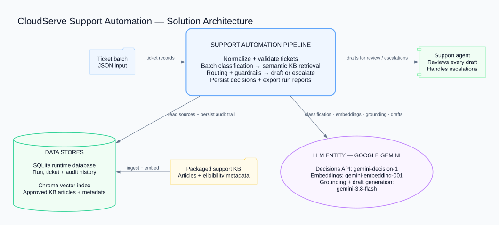

# CloudServe Support Automation Capstone

A self-contained, CLI-first support-ticket automation capstone powered by Google Gemini (`gemini-decision-1`, `gemini-embedding-001`, and `gemini-3.8-flash`) and Chroma.

## Repository layout

- `src/cloudserve_support/` — application package (classification, retrieval, routing, drafting, guardrails, persistence, reporting).
- `conf/` — checked-in frozen routing policy (`conf/frozen_routing_policy.json`).
- `data/kb/` — packaged source KB articles (`documentation.json` and `metadata_manifest.json`).
- `data/index/` — checked-in Chroma vector store (`data/index/chroma/` and `data/index/manifest.json`).
- `data/runtime/` — checked-in SQLite runtime and audit database (`data/runtime/cloudserve.sqlite3`).
- `data/tickets/` — ticket datasets (`validation_tickets.json`, `development_tickets.json`, sample fixtures).
- `data/evaluation/` — evaluation-only ground-truth references (never exposed to operational inference).
- `outputs/` — per-run result exports, metrics, and failure reports.
- `scripts/` — initialization utilities (`init_runtime_db.py`, `init_vector_store.py`, `ingest_kb.py`, `init_output_schemas.py`).
- `setup/` — automated environment setup script (`setup/setup.sh`).
- `tests/` — unit, integration, and acceptance tests.


---

## 1. Installation and environment setup

### What gets installed

- **`uv`** — Python and package manager.
- **Python `3.13.13`** (from `.python-version`, matching `>=3.13,<3.15` in `pyproject.toml`).
- **Pinned dependencies** (from `uv.lock`) inside `.venv`: `chromadb`, `google-genai`, `jsonschema`, `python-docx`, `python-dotenv`, `pytest`, and the `cloudserve` CLI.

Both the Chroma vector store (`data/index/chroma/`) and SQLite runtime database (`data/runtime/cloudserve.sqlite3`) are already checked into the repository and ready immediately after cloning—no DB or vector-store initialization is required for normal use.

### Automated setup (macOS / Linux)

Run inside the repository checkout:

```bash
source setup/setup.sh
```

(Or execute `bash setup/setup.sh` and activate `.venv` afterwards.)

`setup/setup.sh` checks each prerequisite before installing:
1. Locates and uses the existing repository checkout.
2. Installs `uv` and Python `3.13.13` only if not already installed.
3. Copies `.env.example` to `.env` (if missing) and prompts for `GEMINI_API_KEY` (leaving it blank still completes setup cleanly).
4. Syncs `.venv` with `uv sync --frozen`, activates `.venv`, and verifies the checked-in Chroma vector store and SQLite DB.

### Manual setup

**macOS / Linux:**

```bash
uv sync --frozen
cp .env.example .env
source .venv/bin/activate
uv run cloudserve --help
```

**Windows (PowerShell):**

```powershell
uv sync --frozen
Copy-Item .env.example .env
.venv\Scripts\Activate.ps1
uv run cloudserve --help
```

### Environment configuration (`.env`)

Edit `.env` (created from `.env.example`, ignored by Git — never commit `.env`):
- `GEMINI_API_KEY` or `GOOGLE_API_KEY` — required in `.env` (or exported in the shell) before running `cloudserve run`; if missing or blank, the CLI prints an error and stops.
- `DRAFT_GENERATION_PROVIDER` — defaults to `GEMINI` (set `OFFLINE` for extractive drafts).
- `GEMINI_EMBEDDING_MODEL` — defaults to `gemini-embedding-001`.
- `GEMINI_LLM_MODEL` / `GEMINI_QUALITY_JUDGE_MODEL` — defaults to `gemini-3.8-flash`.

---

## 2. Reinitialization (DB and vector store)

Only needed if you want to reset the SQLite database, rebuild the Chroma vector store from scratch, or update KB articles in `data/kb/`. You can run `bash setup/setup.sh --reinit-db` or run the scripts individually:

1. **Reinitialize the SQLite runtime database** (`init_runtime_db.py` creates/verifies `processing_runs`, `ticket_runs`, and `audit_events` without deleting existing rows; delete `data/runtime/cloudserve.sqlite3` first for an empty DB):

   ```bash
   # Optional clean slate (macOS/Linux): rm -f data/runtime/cloudserve.sqlite3
   # Optional clean slate (PowerShell):  Remove-Item -ErrorAction SilentlyContinue data/runtime/cloudserve.sqlite3
   uv run python scripts/init_runtime_db.py
   ```

2. **Reinitialize and re-ingest the Chroma vector store** (`ingest_kb.py` requires `GEMINI_API_KEY` or `GOOGLE_API_KEY` in `.env` and makes Gemini embedding API requests):

   ```bash
   # Optional clean rebuild (macOS/Linux): rm -rf data/index/chroma data/index/manifest.json
   # Optional clean rebuild (PowerShell):  Remove-Item -Recurse -Force -ErrorAction SilentlyContinue data/index/chroma, data/index/manifest.json
   uv run python scripts/init_vector_store.py
   uv run --env-file .env python scripts/ingest_kb.py
   ```

3. **Verify or recreate output JSON schemas**:

   ```bash
   uv run python scripts/init_output_schemas.py
   ```

---

## 3. Run

Run the CLI against the validation set (uses the checked-in routing policy `conf/frozen_routing_policy.json`, Chroma vector store `data/index/chroma/`, and SQLite DB `data/runtime/cloudserve.sqlite3` by default):

```bash
uv run cloudserve run --input data/tickets/validation_tickets.json --skip-draft --skip-draft-review
```

(When `.venv` is activated, `cloudserve run --input data/tickets/validation_tickets.json --skip-draft --skip-draft-review` works directly on macOS, Linux, and Windows PowerShell.)

- `--skip-draft` escalates draft-eligible tickets to human review without calling the draft provider.
- `--skip-draft-review` skips post-generation draft review checks when drafting is enabled.
- Omit `--skip-draft` and `--skip-draft-review` to run full Gemini draft generation and review.
- Outputs (`results.jsonl`, `decision_log.jsonl`, `metrics.json`, `metrics.md`, `exceptions.jsonl`, `failure_report.json`, `failure_report.md`) are written under `outputs/<RUN_ID>/`, and durable records are persisted in `data/runtime/cloudserve.sqlite3`. Running with Gemini keys makes external API requests and may incur provider charges.
- Optional post-run quality judge (when drafts were generated):

  ```bash
  uv run cloudserve evaluate-quality --run-dir outputs/<RUN_ID> --input data/tickets/validation_tickets.json --ground-truth data/evaluation/ground_truth_responses.json
  ```

---

## Tests

```bash
uv run cloudserve --help
uv run pytest
```

`uv run pytest` includes live Decisions API tests that read `GEMINI_API_KEY` or `GOOGLE_API_KEY` from `.env` or the shell and require network access.

## Documentation

- [docs/vector-store-schema.md](docs/vector-store-schema.md) — Chroma whole-article passage schema and freshness checks.
- [docs/sql-database-schema.md](docs/sql-database-schema.md) — SQLite runtime schema (`processing_runs`, `ticket_runs`, `audit_events`).
- [docs/acceptance-evidence.md](docs/acceptance-evidence.md) — A1–A12 acceptance evidence map.
- 
- Pipeline data flow: [docs/data-flow.svg](docs/data-flow.svg) ([dot](docs/data-flow.dot), [png](docs/data-flow.png)).
